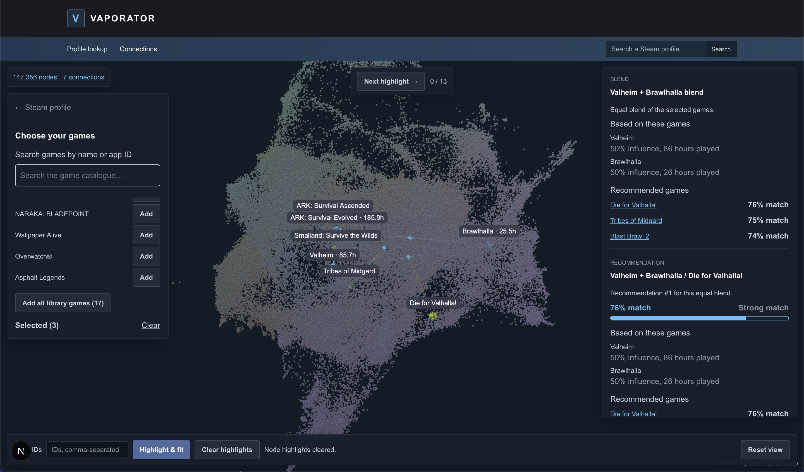

# Vaporator

  

A platform that recommends games to users based on games they already own and reveals some interesting games on steam in the process.

## Features

- Look up a public Steam profile by vanity name or 17-digit Steam ID.
- See a player's most played games and recommendations based on
  their playtime and games they choose.
- Search and select games to explore recommendations and connections.
- Explore the game catalogue with an interactive 3D graph.

## Python backend

The Python package, dependency lockfile, data tools, and tests live in [py/](./py/README.md).

